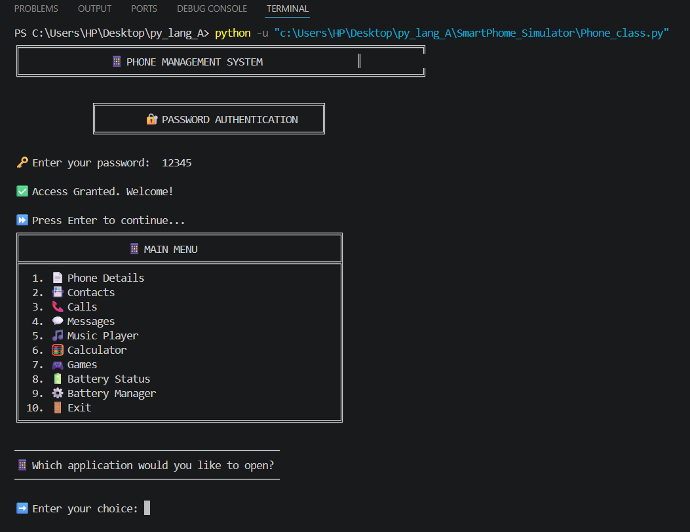
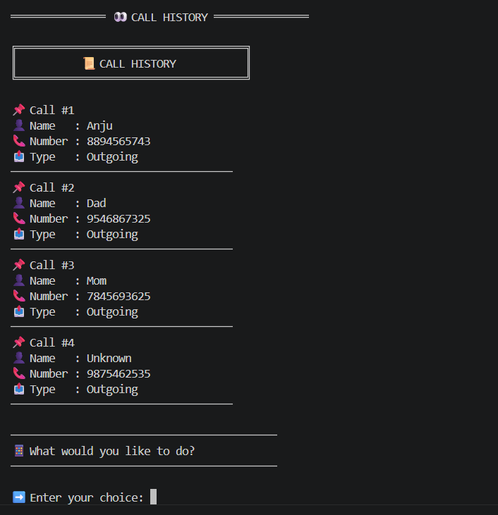
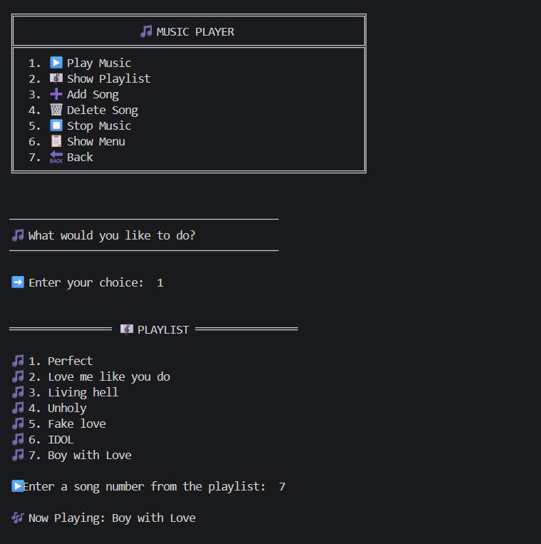
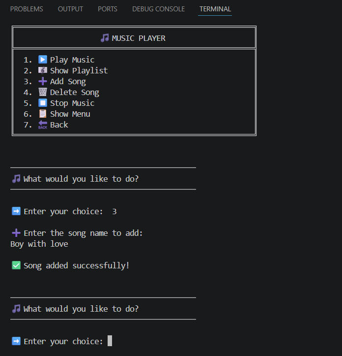
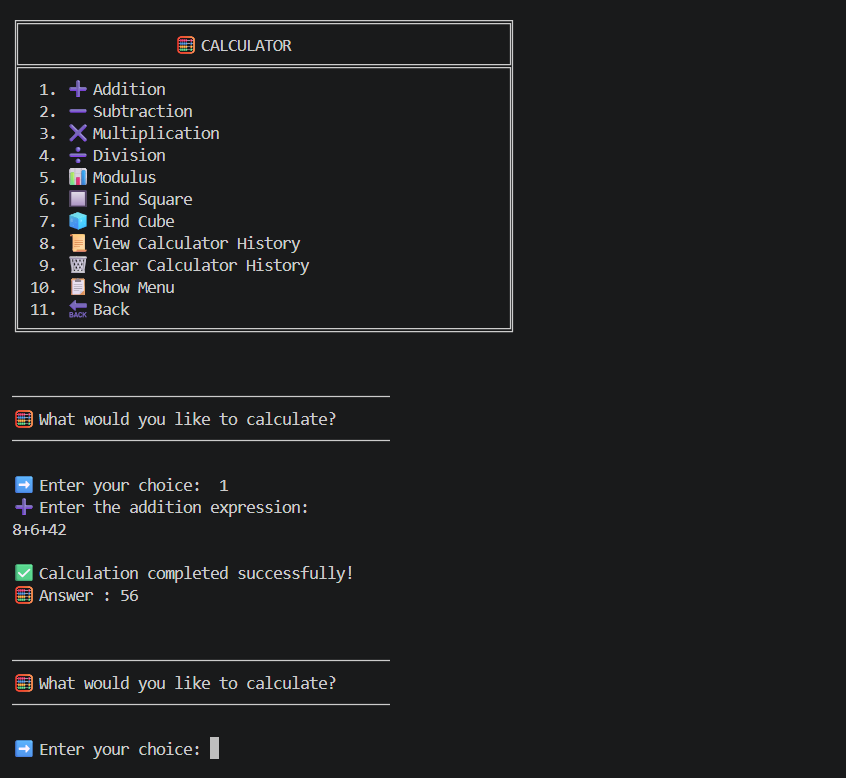
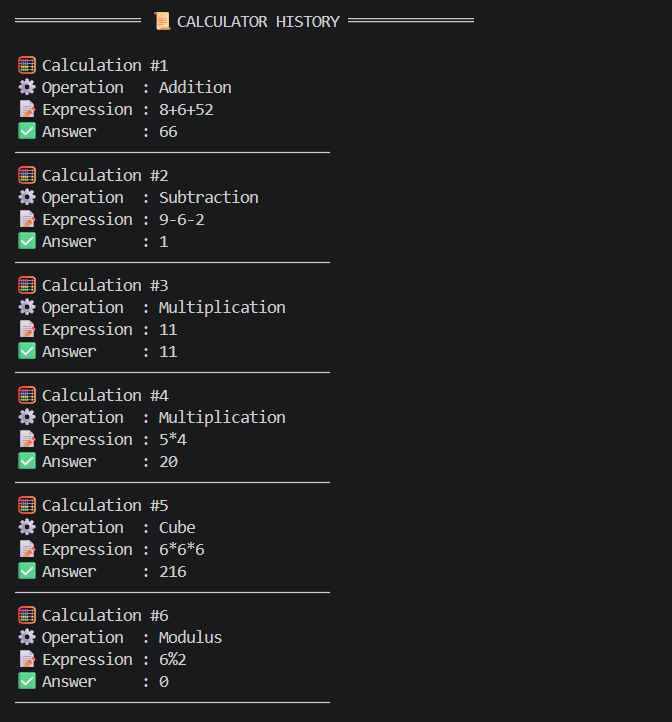
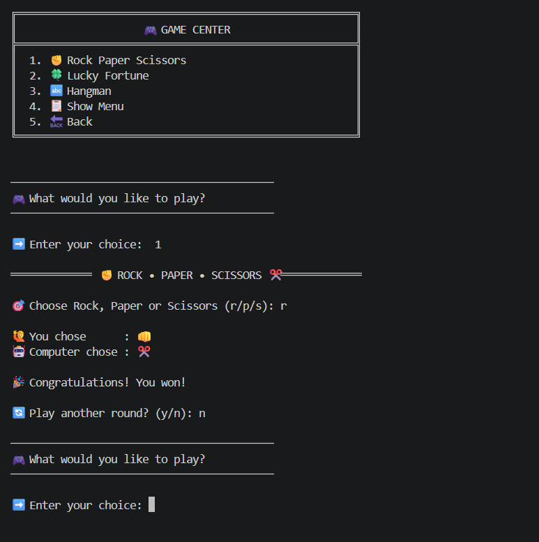
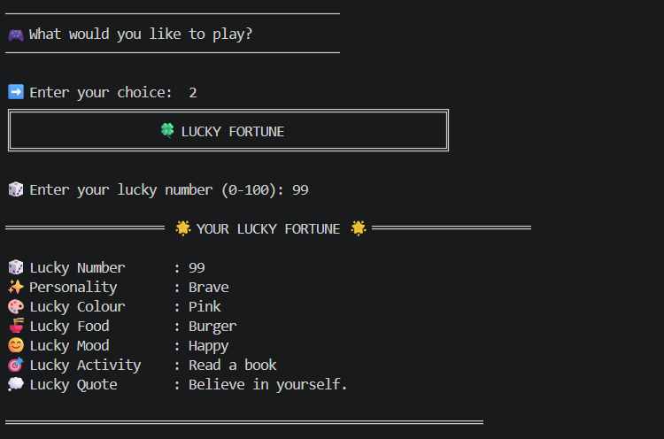

# 📸 Phone Management System — Screenshot Gallery

This folder contains screenshots demonstrating the major modules and features of the **Phone Management System v1.0**.

---

## 📱 Main Menu

The main navigation page of the application showing all available modules.

---

## 📇 Contact Manager

This module allows users to **add, view, search, and manage contacts**.

| Contact Menu                                  | View Contacts                                 |
| --------------------------------------------- | --------------------------------------------- |
|  |  |

---

## 📞 Call Manager

This module supports **making calls, handling unknown numbers, and maintaining call history**.

| Call Menu                                 | Calling Unknown                                 |
| ----------------------------------------- | ----------------------------------------------- |
|  |  |

| Call History                                      |
| ------------------------------------------------- |
|  |

---

## 💬 Message Manager

This module allows users to **send messages and view message history**.

| Message Menu                                 | Message History                                      |
| -------------------------------------------- | ---------------------------------------------------- |
|  |  |

---

## 🎵 Music Manager

This module provides **playlist management and song operations**.

| Music Menu                                 | Add Song                                  |
| ------------------------------------------ | ----------------------------------------- |
|  |  |

---

## 🧮 Calculator Manager

This module supports **arithmetic operations and calculator history tracking**.

| Calculator Menu                                 | Calculator History                                      |
| ----------------------------------------------- | ------------------------------------------------------- |
|  |  |

---

## 🎮 Game Manager

This module contains **mini-games integrated into the phone system**.

| Game Menu                                 | Lucky Fortune                                      |
| ----------------------------------------- | -------------------------------------------------- |
|  |  |

---

## 🔋 Battery Manager

---

# 📊 Screenshot Summary

| Module        | Features Demonstrated     | Screenshots |
| ------------- | ------------------------- | ----------- |
| 📱 Main Menu  | Navigation interface      | 1           |
| 📇 Contacts   | Add / View contacts       | 2           |
| 📞 Calls      | Call operations & history | 3           |
| 💬 Messages   | Send & View messages      | 2           |
| 🎵 Music      | Playlist & Add song       | 2           |
| 🧮 Calculator | Operations & History      | 2           |
| 🎮 Games      | Game menu & gameplay      | 4           |
| 🔋 Battery    | Charging & Status         | 1           |

**Total Screenshots: 17**

---

# 🎯 Purpose of This Gallery

These screenshots provide a visual overview of the **Phone Management System v1.0** and demonstrate:

* 📱 Modular console-based application design
* 🧠 Object-Oriented Programming structure
* 🎨 Professional terminal user interface
* 📂 Multiple independent manager modules
* 🔋 Shared battery management system
* 📊 Runtime history management

This gallery serves as the **visual documentation** for the released **Phone Management System v1.0** project.

